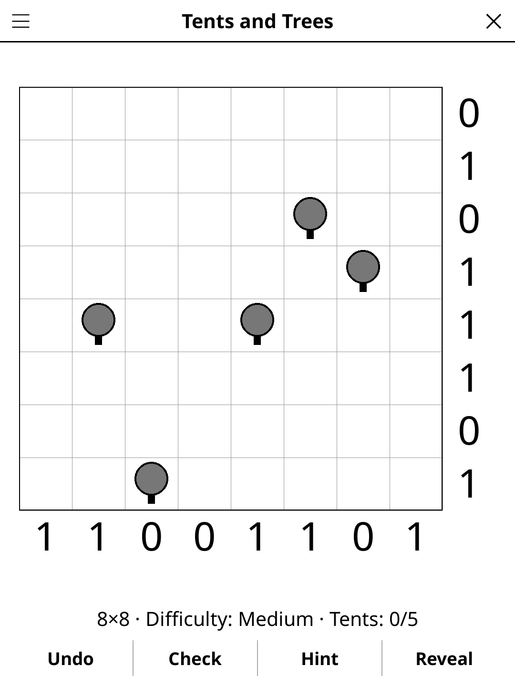

# tents.koplugin

A Tents and Trees plugin for [KOReader](https://github.com/koreader/koreader).

## Screenshot

## Rules

Place tents adjacent to trees: each tree pairs with exactly one orthogonally adjacent tent; each tent pairs with one tree. No two tents may touch (even diagonally). Row and column clue counts must be satisfied.

## Concept

Place tents in the grid so that:

1. Each tree is paired with exactly one tent in an orthogonally adjacent cell.
2. Each tent is paired with exactly one tree.
3. No two tents are adjacent (not even diagonally).
4. The number of tents in each row and column matches the clue for that line.

Tree positions and row/column clues are given; deduce where every tent goes.

## Features

- **Multiple grid sizes** — 6×6, 8×8, 10×10, 12×12
- **Hint** — two taps: the first says which cell is about to give, the second acts on it
- **Three difficulty levels** — Easy, Medium, Hard: more trees and harder
  deductions at each level; every puzzle has exactly one solution and never
  needs trial and error
- **Cell states** — empty, tent, grass (confirmed non-tent)
- **Check** — highlights contradictions with row/column clues and adjacency rules
- **Reveal solution** — shows the full solution
- **Undo** — step back through your moves
- **Auto-save** — game state saved and restored on next launch

## Controls

| Action | How |
|--------|-----|
| Cycle a cell: tent, grass, empty | Tap the cell |
| Mark a cell as grass | Long-press the cell |
| Undo last move | Tap **Undo** |
| Check progress | Tap **Check** |
| Get a hint | Tap **Hint** |
| Show the solution | Tap **Reveal** |
| New game, Daily Challenge, size, difficulty, rules | Menu (top left) |

## Why e-ink friendly?

Three distinct cell states (empty / tent / grass) render as simple glyphs.
The grid is fully static between moves — minimal screen refresh needed.

## License

GPL-3.0
